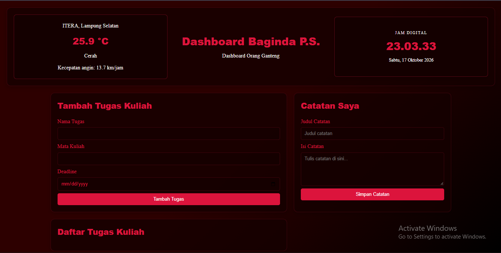
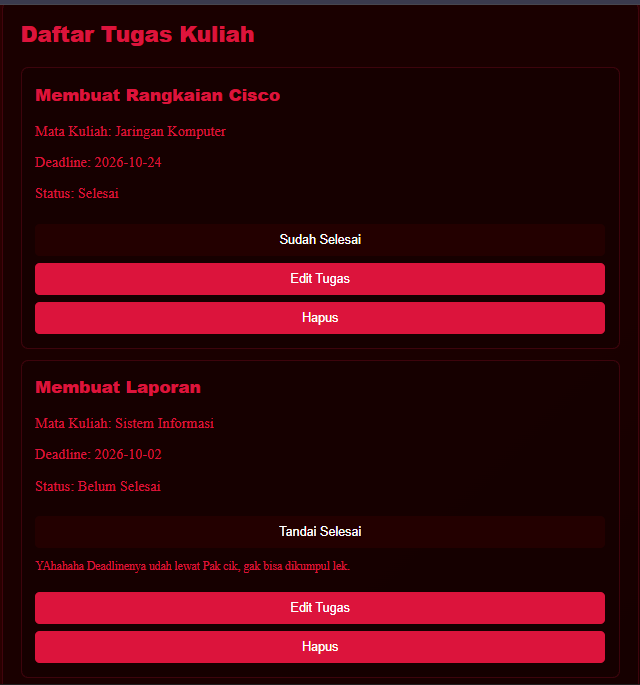
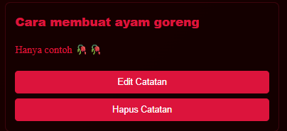
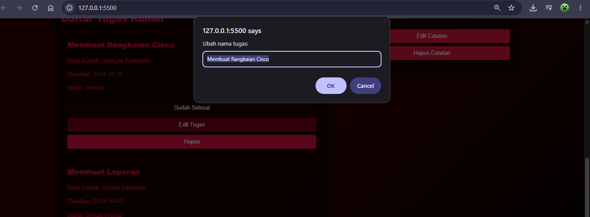

# Personal Dashboard

Personal Dashboard adalah aplikasi web sederhana untuk membantu mahasiswa melihat informasi cuaca ITERA, waktu dan tanggal, mengelola tugas kuliah, serta menyimpan catatan pribadi.

## Fitur

- Menampilkan jam digital dan tanggal dengan zona waktu Asia/Jakarta.
- Mengambil informasi cuaca saat ini untuk area ITERA melalui API Open-Meteo.
- Menambah, mengedit, menandai selesai, dan menghapus tugas kuliah.
- Menambah, mengedit, dan menghapus catatan pribadi.
- Menyimpan tugas dan catatan di `localStorage`, sehingga data tetap tersedia saat halaman dimuat ulang pada browser yang sama.
- Tata letak responsif untuk desktop, tablet, dan ponsel.

## Struktur proyek

```text
BagindaPS_124140135_pertemuan2/
├── index.html
├── README.md
├── css/
│   └── style.css
├── js/
│   ├── main.js
│   ├── app.js
│   └── modules/
│       ├── data.js
│       └── utils.js
├── Screenshot/
│   ├── catatan.png
│   ├── daftarTugas.png
│   ├── dashboard.png
│   ├── mengubahCatatan.png
│   └── MengubahDetailTugas.png

```

## Cara menjalankan

1. Ekstrak folder proyek.
2. Buka folder proyek di Visual Studio Code.
3. Jalankan `index.html` menggunakan ekstensi Live Server.
4. Pastikan koneksi internet tersedia agar informasi cuaca dari Open-Meteo dapat dimuat.

## Penerapan JavaScript ES6+

| Fitur | Contoh penggunaan | Lokasi |
|---|---|---|
| `const` dan `let` | Menyimpan elemen DOM, data tugas, catatan, dan variabel lokal | `js/main.js` |
| Arrow function | Callback event, fungsi render, dan fungsi pembaruan | `js/main.js`, `js/modules/utils.js` |
| Template literals | Membentuk kartu tugas, kartu catatan, dan informasi cuaca | `js/main.js` |
| Class | `TaskItem`, `NoteItem`, dan `DashboardApp` | `js/main.js` |
| Method dan constructor | Membuat objek serta mengatur perilaku tugas dan catatan | `js/main.js` |
| Destructuring/properti objek | Membentuk objek tugas dan catatan dengan properti | `js/main.js` |
| Spread operator | Tidak digunakan pada versi saat ini; data tugas diperbarui langsung melalui objek | — |
| Module `import`/`export` | Mengimpor `simpanData` dan `ambilData` | `js/main.js`, `js/modules/utils.js` |
| Async/await dan Fetch API | Mengambil data cuaca Open-Meteo | `js/main.js`, method `tampilkanCuaca()` |
| Array methods | `map()`, `filter()`, dan `find()` untuk menampilkan serta mengelola data | `js/main.js` |
| `localStorage` | Menyimpan dan membaca data tugas serta catatan | `js/modules/utils.js` |

## Screenshot
### Tampilan Dashboard

### Tampilan Daftar Tugas

### Tampilan Daftar Catatan

### Tampilan Mengedit detail Tugas

### Tampilan Mengedit detail catatan


## Catatan

Data disimpan di browser melalui `localStorage`, bukan di server. Data tidak otomatis tersinkronisasi ke perangkat atau browser lain. Informasi cuaca membutuhkan koneksi internet.
