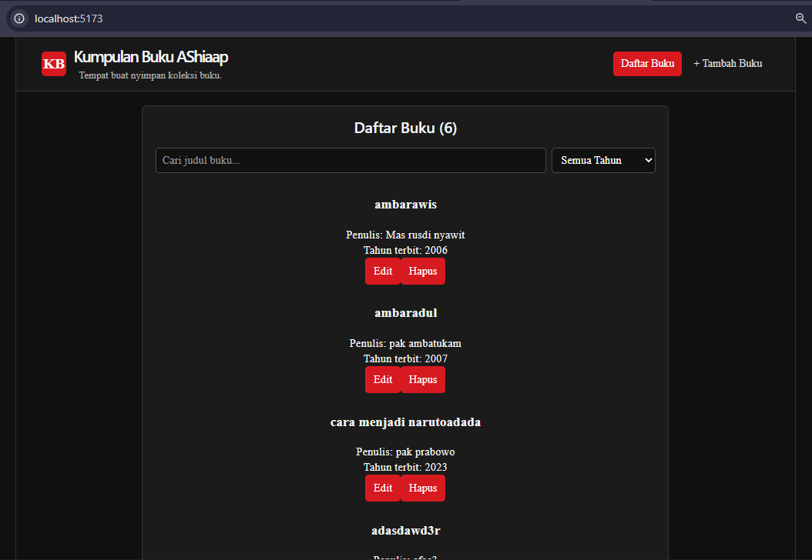
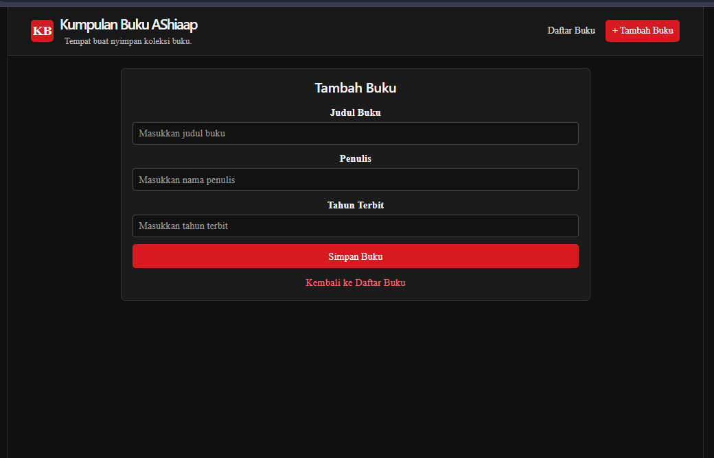
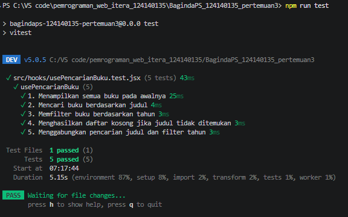

# Aplikasi Manajemen Buku

## Deskripsi
Aplikasi berbasis React untuk mengelola koleksi buku.
Pengguna dapat menambah, melihat, mencari, mengedit,
dan menghapus data buku.

## Fitur
- Menambah buku.
- Menampilkan daftar buku.
- Mengedit dan menghapus buku.
- Mencari buku berdasarkan judul.
- Memfilter buku berdasarkan tahun terbit.
- Menyimpan data menggunakan localStorage.
- Menggunakan Context API untuk berbagi data.
- Menggunakan React Router untuk navigasi.
- Menggunakan custom hooks.
- Menggunakan PropTypes untuk validasi props.
- Memiliki unit test menggunakan Vitest.

## Teknologi
- React
- Vite
- React Router
- Vitest
- JavaScript
- CSS

## Cara Menjalankan
1. Instal dependensi dengan `npm install`.
2. Jalankan aplikasi dengan `npm run dev`.
3. Buka alamat lokal yang ditampilkan terminal.

## Pengujian
Jalankan unit test dengan: `npm run test`

Periksa build produksi dengan: `npm run build`

## Screenshot
### Halaman Daftar Buku

### Halaman Tambah Buku

### Hasil Unit Test
