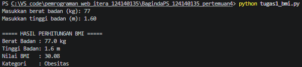
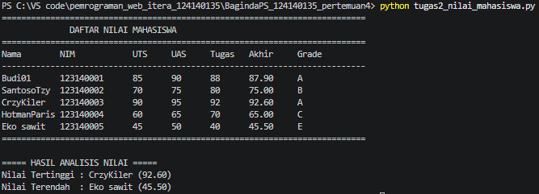
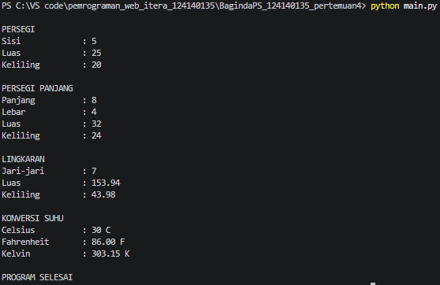

# Praktikum PAW Pertemuan 4 - Python Dasar

## Identitas Mahasiswa

- **Nama:** Baginda Parulian Siregar
- **NIM:** 124140135
- **Kelas:** RB

## Deskripsi Tugas

### 1. Program Penghitung BMI

File: `tugas1_bmi.py`

Program ini digunakan untuk menghitung Body Mass Index (BMI) berdasarkan berat badan dan tinggi badan pengguna. Hasil perhitungan kemudian dikategorikan menjadi berat badan kurang, normal, berlebih, atau obesitas.

Cara menjalankan:

```bash
python tugas1_bmi.py
```

### 2. Program Pengolahan Nilai Mahasiswa

File: `tugas2_nilai_mahasiswa.py`

Program ini menggunakan list dan dictionary untuk menyimpan data mahasiswa. Nilai akhir dihitung berdasarkan nilai UTS, UAS, dan tugas. Program juga menentukan grade serta mahasiswa dengan nilai tertinggi dan terendah.

Cara menjalankan:

```bash
python tugas2_nilai_mahasiswa.py
```

### 3. Modul Operasi Matematika

File: `math_operations.py` dan `main.py`

Program ini menggunakan modul Python untuk menghitung luas dan keliling persegi, persegi panjang, serta lingkaran. Program juga menyediakan fungsi konversi suhu Celsius ke Fahrenheit dan Kelvin.

Cara menjalankan:

```bash
python main.py
```

## Bukti Hasil Program

### Tugas 1 - Penghitung BMI



### Tugas 2 - Pengolahan Nilai Mahasiswa



### Tugas 3 - Modul Operasi Matematika

